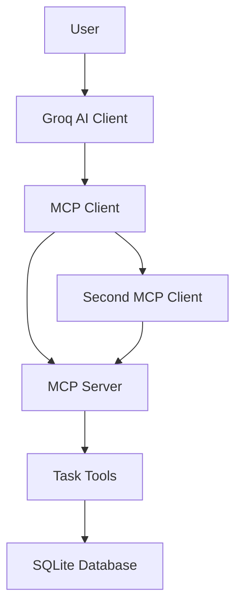

# MCP Personal Task Assistant

A tool-using AI assistant built with Python, Groq and Model Context Protocol (MCP) to manage personal tasks using natural language.

## Overview

This project demonstrates how an LLM can interact with external functionality through MCP tools. Users can add, view, complete and delete tasks using natural language.

The application uses Groq as the LLM provider, MCP for standardized tool communication, and SQLite for persistent task storage.

## Architecture



## Features

- Add new tasks
- Retrieve all tasks
- Mark tasks as completed
- Delete tasks
- LLM-powered tool selection
- MCP tool discovery
- MCP client-server communication using stdio
- Second client demonstrating MCP server reusability
- SQLite persistent storage

## Tech Stack

- Python
- Model Context Protocol (MCP)
- Groq API
- SQLite
- Asyncio
- python-dotenv

## Project Structure

```text
mcp_prac/
├── client.py
├── mcp_test_client.py
├── server.py
├── database.py
├── .env
├── .gitignore
├── requirements.txt
└── tasks.db
```

## How It Works

1. The user sends a request in natural language.
2. The Groq LLM interprets the request and selects an appropriate tool.
3. The MCP client discovers available tools from the MCP server.
4. The MCP client sends the selected tool request to the server.
5. The server executes the corresponding Python function.
6. The database module performs the operation in SQLite.
7. The result is returned to the LLM.
8. The LLM generates a response for the user.

## Available MCP Tools

| Tool | Description |
|---|---|
| `create_new_task` | Creates a new task |
| `get_all_tasks` | Retrieves all tasks |
| `mark_task_completed` | Marks a task as completed |
| `remove_task` | Deletes a task |

## Installation

### 1. Clone the repository

```bash
git clone https://github.com/bindu760/mcp_prac.git
cd mcp_prac
```

### 2. Create a virtual environment

```bash
python -m venv env
```

### 3. Activate the virtual environment

Windows:

```bash
env\Scripts\activate
```

### 4. Install dependencies

```bash
pip install -r requirements.txt
```

### 5. Configure API key

Create a `.env` file in the project root:

```env
GROQ_API_KEY=your_groq_api_key
```

### 6. Run the AI assistant

```bash
python client.py
```

## Testing MCP Without an LLM

A second client is included to demonstrate that the MCP server can be accessed without using an LLM.

Run:

```bash
python mcp_test_client.py
```

This client discovers tools and directly calls the MCP server to add and retrieve tasks.

## MCP Demonstration

The project uses two clients:

- `client.py`: Uses Groq LLM for natural-language tool selection.
- `mcp_test_client.py`: Direct MCP client that calls tools without an LLM.

Both clients interact with the same MCP server and reuse the same tool implementations.

## What I Learned

- MCP client-server architecture
- MCP tool registration using FastMCP
- Tool discovery and invocation
- LLM tool calling
- Async Python programming
- SQLite integration
- Reusable tool interfaces through MCP

## Future Improvements

- Task priorities and due dates
- Update task functionality
- User authentication
- Web-based UI
- Multiple MCP server integrations
- Improved error handling and validation